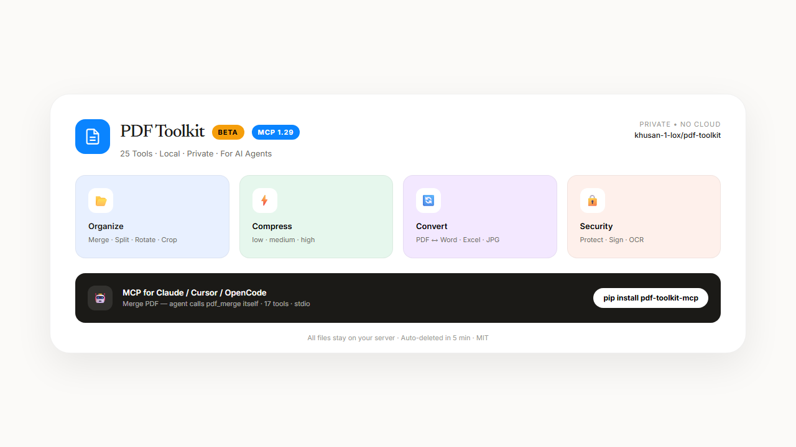

<p align="center">
  
</p>

<h1 align="center">PDF Toolkit</h1>
<p align="center"><b>25 Tools · Local · Private · Free MCP for AI Agents</b></p>
<p align="center">🌐 Languages: <a href="frontend/messages/en.json">EN</a> | <a href="frontend/messages/ru.json">RU</a> — Web served at <code>/en</code> and <code>/ru</code> (default <code>en</code>, auto-detect)</p>

<p align="center">
  <a href="https://github.com/khusan-1-lox/pdf-toolkit/releases/tag/v1.0.0-beta.1"></a>
  <a href="mcp/"></a>
  <a href="LICENSE"></a>
  
  
</p>

<p align="center">
  
</p>

<p align="center">
  <b>Merge · Split · Compress · Convert · OCR · Protect</b> — stays on your server. Auto-deleted in 5 minutes. No cloud.
</p>

---

### ✨ What's inside

| | Tools |
|---|---|
| **📂 Organize** | Merge, Split, Delete Pages, Rotate, Crop, Compare, Organize |
| **⚡ Optimize** | Compress PDF (low / medium / high) |
| **🔄 Convert** | PDF ↔ JPG, Word ↔ PDF, Excel ↔ PDF, PowerPoint ↔ PDF, PDF → Excel/PPT, HTML → PDF, PDF/A |
| **✏️ Edit** | Watermark, Page Numbers, Sign, Redact, OCR (eng+rus), Repair |
| **🔒 Security** | Protect with password (128-bit), Unlock |

> **BETA** — testing with friends. Download installer in [Releases](https://github.com/khusan-1-lox/pdf-toolkit/releases).

---

### 🖥️ Software

**Web** — `docker compose up --build` → http://localhost:3000/en (or /ru, auto-redirect)  
**Desktop** — `PDF Toolkit BETA` (Electron, Windows) — offline, 25 tools without browser. Download: [Release v1.0.0-beta.1](https://github.com/khusan-1-lox/pdf-toolkit/releases/tag/v1.0.0-beta.1)

<p align="center">
  
</p>

---

### 🤖 MCP — Give Your AI Agent PDF Superpowers

Free, local, no API key. The agent calls tools itself.

**Step 1 — Install**

```bash
pip install mcp==1.29.1 pydantic pypdf PyMuPDF Pillow python-docx openpyxl python-pptx pdf2docx pdfplumber
```

**Step 2 — Connect**

Claude Desktop (`%APPDATA%\Claude\claude_desktop_config.json`):

```json
{
  "mcpServers": {
    "pdf-toolkit": {
      "command": "python",
      "args": ["C:/path/to/pdf-toolkit/mcp/server.py"]
    }
  }
}
```

Cursor / OpenCode / VS Code + Cline — same `mcp.json`.

**Step 3 — Prompts**

```
Merge /tmp/a.pdf and /tmp/b.pdf via pdf_merge
Compress /tmp/big.pdf with low quality via pdf_compress
Make /tmp/scan.pdf searchable with Russian language via ocr_pdf
```

<details>
<summary>All 17 MCP tools</summary>

`pdf_merge` · `pdf_split` · `pdf_compress` · `pdf_rotate` · `pdf_delete_pages` · `pdf_watermark` · `pdf_to_jpg` · `jpg_to_pdf` · `word_to_pdf` · `pdf_to_word` · `pdf_to_excel` · `pdf_to_ppt` · `excel_to_pdf` · `ppt_to_pdf` · `ocr_pdf` · `pdf_protect` · `pdf_unlock`

</details>

Verify: `npx @modelcontextprotocol/inspector python mcp/server.py` · Docker: `docker build -f mcp/Dockerfile -t pdf-toolkit-mcp .`

<p align="center">
  
</p>

---

### 🚀 Quick Start

```bash
git clone https://github.com/khusan-1-lox/pdf-toolkit
cd pdf-toolkit
docker compose up --build
```

### 📁 Structure

```
pdf-toolkit/
  backend/   # FastAPI, 26 routes
  frontend/  # Next.js 14
  mcp/       # MCP server (stdio)
  desktop-electron/ # Electron BETA
```

### 📜 License

MIT — do what you want, privacy by default.
